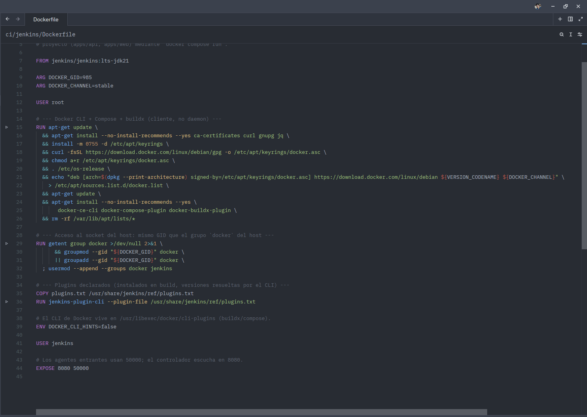
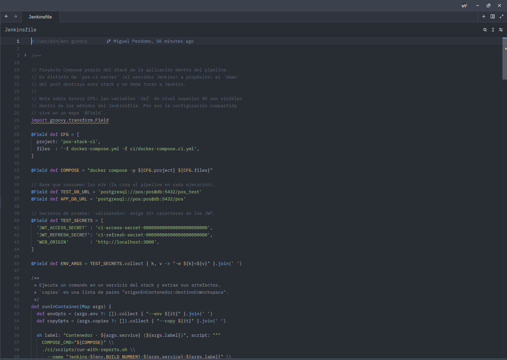
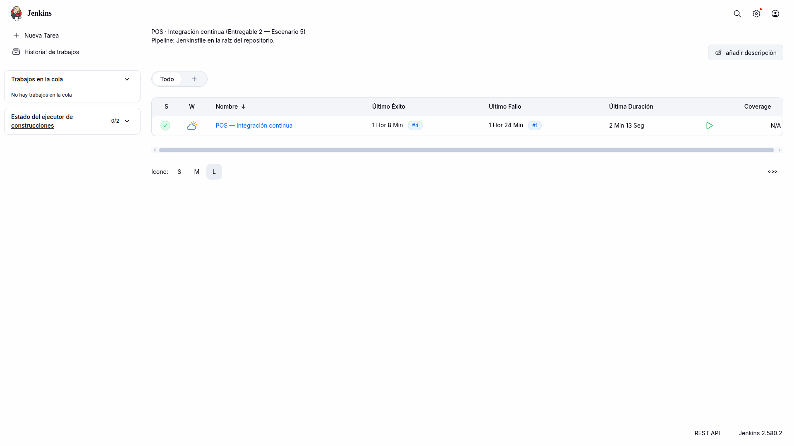
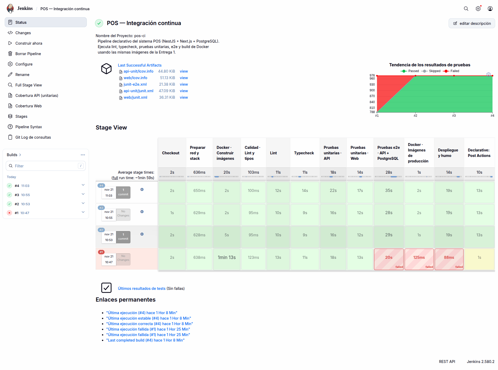
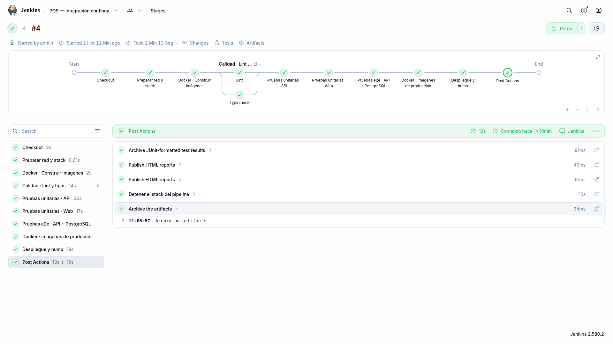
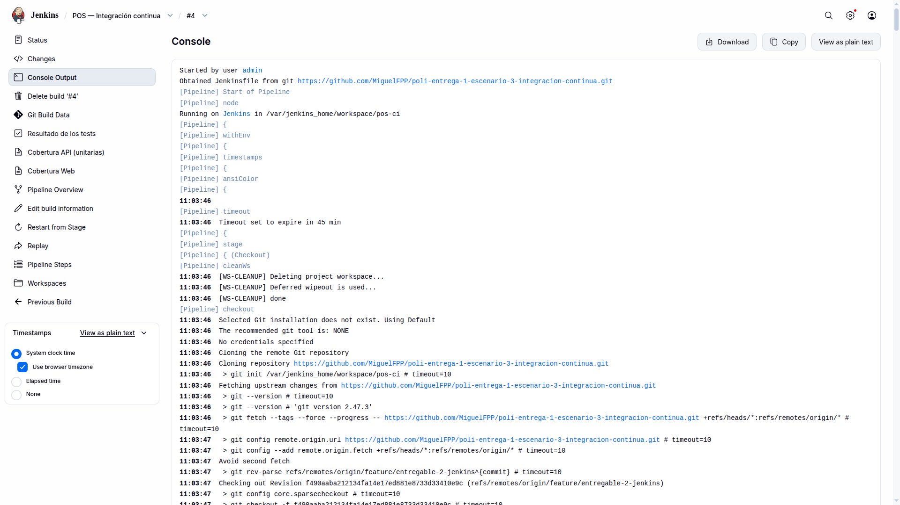
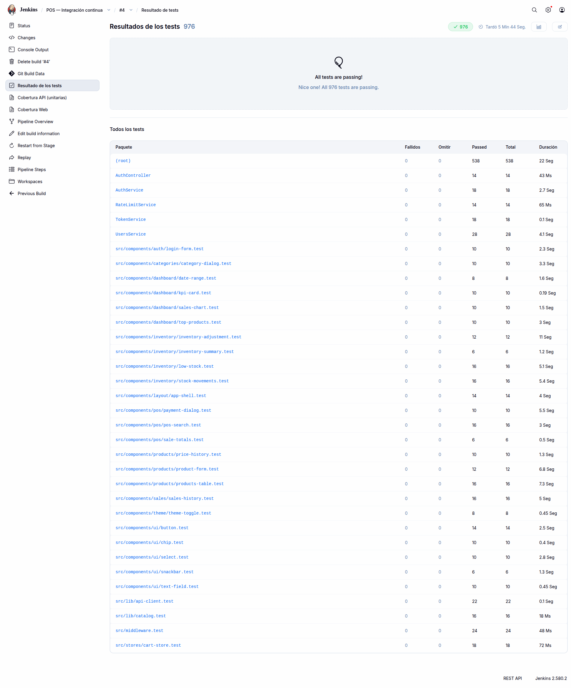
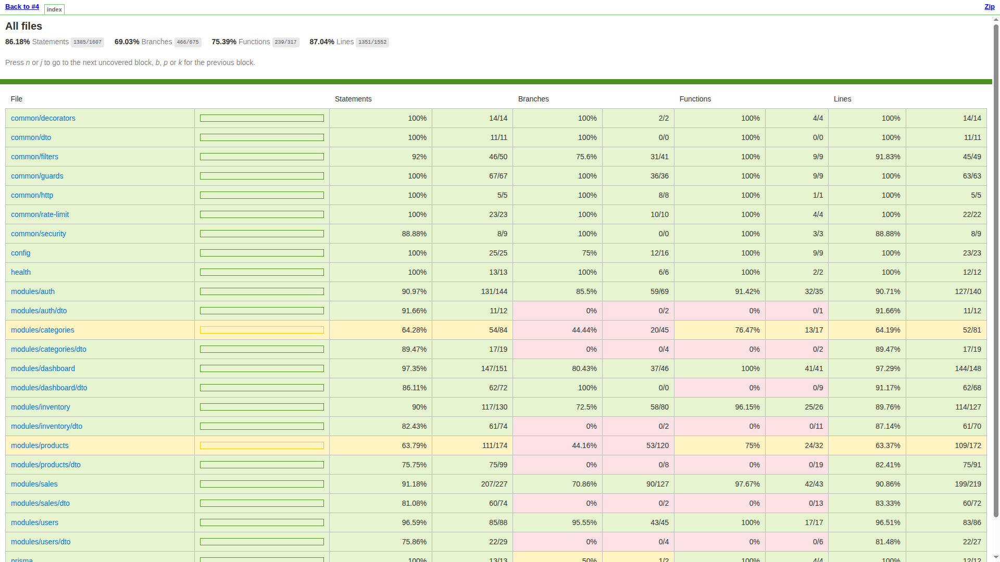
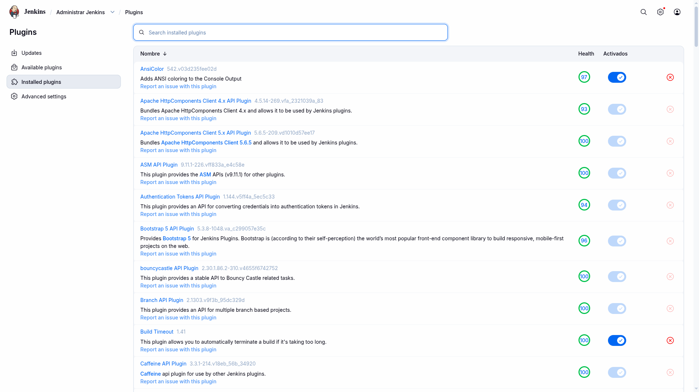

# Evidencias del procedimiento — Entregable 2

Este documento acompaña las capturas del trabajo que hicimos en equipo para el segundo entregable. La idea es la misma del primero: contar en palabras sencillas que se ve en cada imagen y que aprendimos en el camino. Las capturas están en esta misma carpeta y en sus subcarpetas.

El entregable trataba sobre la integración continua, asi que aqui aparecen tres cosas que se juntan: GitHub como lugar donde vive el código, Docker como lugar donde se ejecuta y Jenkins como el que pone orden y arranca todo solo.

## 1. La rama y el primer commit

### Captura 1 — Crear la rama del entregable

Aqui se ve el momento en que separamos el trabajo de esta entrega del trabajo anterior. Con `git checkout -b feat/entregable-2-jenkins` nace una rama nueva a partir de `main`, y así todo lo de Jenkins queda aparte sin ensuciar la rama principal.

Despues comprobamos con `git branch --show-current` que de verdad estábamos parados en la rama nueva. Ese paso parece de mas pero no lo es porque mas de una vez uno cree que cambió de rama y sigue en la de antes.

Al final aparecen `git add -A`, `git status` y `git diff --cached --stat`. Ahí confirmamos que los archivos nuevos de `ci/` y el `Jenkinsfile` estaban listos para entrar. Trabajar en una rama propia tiene una ventaja grande, si algo sale mal se borra la rama y no pasa nada en `main`.

## 2. Las recetas de Jenkins

### Captura 2 — El Dockerfile de Jenkins

Este archivo es la receta de la imagen de jenkins. Parte de `jenkins/jenkins:lts-jdk21`, que ya trae Java 21 y la versión estable de Jenkins, y encima le agrega lo que hace falta para este proyecto.

Lo primero que se instala es el cliente de docker no el servidor. Eso es a propósito, porque Jenkins no necesita su propio Docker: usa el que ya está en la máquina anfitriona a través del socket. También se instalan Compose y buildx, que son las herramientas con las que el pipeline construye y levanta los contenedores del POS.

Hay un detalle que nos costo entender al princio. El usuario `jenkins` dentro del contenedor tiene que compartir el mismo número de grupo que el dueño del socket en el sistema anfitrión. Si no coinciden, aparece un error de permisos que no dice nada claro. Por eso el `ARG DOCKER_GID` y el `groupmod` están ahí.

Al final se copian los plugins y se instalan con `jenkins-plugin-cli`. Todo queda listo en la construccion asi que cuando el contenedor arranca ya tiene lo que necesita.

### Captura 3 — La lista de plugins

Aqui esta la lista de plugins que se instalan. Están agrupados por para qué sirven, y eso ayuda mucho cuando alguien revisa el proyecto después.

El primer grupo es el mas importante para nosotros. `configuration-as-code` es el que permite describir Jenkins en un archivo de texto en vez de hacer clics. `job-dsl` es el que crea el trabajo automáticamente. Con esos dos el servidor queda armado solo y esa es la diferencia entre una práctica que se puede repetir y una que solo funcionó una vez en una máquina.

El segundo grupo son los del pipeline declarativo, que son los que dibujan las etapas y las vueltas de cada una. El tercero conecta con GitHub. El cuarto es el que produce los reportes que después se ven en el navegador.

Hay un comentario que vale la pena leer con calma, Ahí dice que `buildx` no es un plugin de Jenkins sino un programa aparte. Nos confundimos con eso y lo pusimos en la lista, y la construcción falló con un error de dependencias que no logramos cumplir. La solucion fue sacarlo de la lista y dejarlo solo en el Dockerfile.

### Captura 4 — La configuración del servidor

Este es el archivo que Jenkins lee al arrancar para configurarce solo. Se llama configuración como código y la idea es sencilla: si el servidor está descrito en un archivo, entonces se puede borrar y volver a crear igual.

Arriba estan los datos basicos el mensaje del panel de control los dos ejecutores y las etiquetas. Los ejecutores son los que hacen el trabajo, y con dos alcanza para este proyecto.

La parte de seguridad dice que nadie puede registrarse por su cuenta,, que el usuario administrador se crea desde las variables de entorno y que sin iniciar sesión no se ve nada. Esa última línea es la que evita que alguien entre sin permiso y vea los reportes.

También aparece el bloque de GitHub, que guarda la dirección del gancho y la de la interfaz de programación. Y mas abajo aunque no cabe en la imagen esta la definición del trabajo `pos-ci`. Ahí se declara de dónde sale el código, qué rama se mira y cada cuánto se revisa si hay cambios.

## 3. El pipeline

### Captura 5 — El Jenkinsfile

Este es el archivo mas importante del entregable. Ahí se describe, paso a paso, qué tiene que hacer Jenkins cada vez que hay un cambio.

Lo primero que se ve son las variables compartidas. `pos-stack-ci` es el nombre del proyecto de Compose que usa el pipeline, y está aparte del nombre del servidor de Jenkins. Eso no fue casualida. Al principio los dos tenían el mismo nombre y el cierre del pipeline apagaba a Jenkins sin avisar, porque Compose creyó que eran la misma cosa.

Despues aparecen las direcciones de las bases y los secretos de prueba. Los secretos tienen que pasar de 32 caracteres porque la API los valida al arrancar, y eso no lo sabíamos cuando escribimos la primera versión.

La función `runInContainer` es la que resuelve el problema mas raro de todo el entregable Jenkins y los contenedores no ven los mismos archivos aunque parezcan la misma máquina. Por eso no sirve montar una carpeta con los reportes, y en cambio el script los copia al terminar con `docker cp`.

### Captura 6 — El script que rescata los reportes

Este script es el que ejecuta las pruebas dentro del contenedor y despues se lleva los resultados. Tiene un comentario largo al principio explicando por qué existe, y ese comentario vale la pena leerlo antes de cambiarle algo.

Acepta tres tipos de argumentos, Con `--name` le damos un nombre al contenedor temporal, con `--service` se elige en cuál servicio corre el comando, y con `--env` se le pasan las variables de entorno. Este último fue una corrección de último momento, porque las pruebas de integración necesitan saber a qué base conectarse.

El argumento `--copy` es el que mejor resume la idea, Recibe un par de rutas separadas por dos puntos. La primera es la ruta dentro del contenedor, la segunda es dónde queda en la máquina de Jenkins. El script usa `docker cp` para la traducción.

También se ve el manejo de argumentos con un `case`, que es la forma honesta de hacerlo en un script de shell. No es elegante pero se entiende y para una practica eso es suficiente.

## 4. Los archivos de Compose

### Captura 7 — El servidor de Jenkins

Este archivo describe el contenedor de jenkins. Se construye con el Dockerfile de la carpeta vecina, se llama `pos-jenkins` y arranca siempre que la máquina esté prendida.

En el ambiente se ven las variables que se pasan al servidor, `CASC_JENKINS_CONFIG` es la que le dice dónde está el archivo de configuración, y las de administrador definen el usuario y la contraseña con los que entramos. Los valores de la imagen son solo para desarrollo, y en un ambiente de verdad habría que cambiarlos.

Los volumenes son tres y cada uno tiene su razon. El primero guarda el historial de Jenkins para que no se pierda al reiniciar. El segundo es el socket de Docker, que es la puerta por la que Jenkins habla con el Docker de la máquina. El tercero es el archivo de configuración montado en solo lectura.

Ese montaje del socket tiene una consecuencia que explicamos en el documento tecnico. Jenkins puede crear y borrar contenedores, pero el Docker de la máquina no puede leer las carpetas que solo existen dentro de Jenkins. Por eso el script de antes usa `docker cp` en vez de un montaje normal.

### Captura 8 — El ajuste para el pipeline

Este es un archivo de ajustes que se aplica ensima del principal. Su trabajo es que el pipeline no choque con el entorno de desarrollo que uno tenga abierto.

La primera línea con `!reset null` quita los nombres fijos de los contenedores. Sin eso, si uno ya tiene la base de datos levantada para trabajar, el pipeline no podría crear la suya y fallaría. Con el reset los contenedores del pipeline llevan un prefijo propio.

La segunda linea quita los puertos publicados. El pipeline no necesita que nadie entre desde afuera, y no publicar puertos evita el error de puerto ocupado, que es de los más molestos.

Más abajo se ve la red. `pos-ci-net` es una red externa, y esa palabra es la clave. Externa quiere decir que la red ya existe y Compose no la crea ni la borra. Asi Jenkins y los contenedores del pipeline pueden verse sin que ninguno de los dos sea dueño de la red.

## 5. La instalación desde la terminal

### Captura 9 — Crear la red y construir la imagen

Aqui empieza la instalacion de verdad. Primero se crea la red con `docker network create pos-ci-net`, y Docker devuelve un identificador largo que confirma que quedó hecha.

Después viene la construcción de la imagen con `docker compose -f ci/docker-compose.yml build jenkins`. La salida es larga pero se lee con paciencia, Cada línea `CACHED` quiere decir que Docker aprovechó un paso que ya había hecho antes, y por eso las capas de los plugins aparecen en cero segundos.

Esa reutilisación es una de las ventajas de las imágenes por etapas. Como el archivo de plugins no cambió, la instalación de plugins se saltó completa y la construcción terminó en un par de segundos en vez de minutos.

Al final dice `Image pos-jenkins:lts Built`. Esa es la confirmacion de que la receta funciono y que la imagen esta lista para usarse.

### Captura 10 — Confirmar que quedó bien

Esta es la captura que uno debe mostrar cuando le preguntan si la instalacion funciono. Son varios comandos seguidos y cada uno responde una pregunta distinta.

`docker compose ps` muestra el contenedor en estado `healthy`. Ese estado lo pone Docker solo cuando el chequeo automático responde bien, así que vale más que un simple «está corriendo».

`docker compose config --services` confirma que el servicio se llama `jenkins`. Parece obvio pero sirve cuando uno tiene varios archivos de Compose, y no recuerda cuál está leyendo.

El conteo de plugins devuelve 106 archivos. Ese número es más alto que el de la lista porque cada plugin arrastra sus propias dependencias. No hay que asustarse ni pensar que se instaló algo de más.

Los dos comandos de `docker exec` son los que mas nos gustan. Uno lista las carpetas de trabajos y aparece `pos-ci`, que es el trabajo que se creó solo. El otro lee la configuración de ese trabajo y muestra la rama que está siguiendo. Ahí se comprueba que la configuración como código hizo su trabajo sin que nadie tocara la interfaz.

Al final, el `curl` a la portada respondió `200`. Esa es la prueba de que el servidor esta atendiendo peticiones de verdad.

## 6. El panel de Jenkins

### Captura 11 — El panel de control

Esta es la primera pantalla que ve uno al entrar a `http://localhost:8080`, Arriba está el mensaje que definimos en la configuración, que sirve para que cualquiera entienda de qué es el servidor.

En el centro aparece la lista de trabajos, y ahí está `POS — Integración continua` con la última ejecución correcta, la última fallida y la duración. Del lado izquierdo están la cola de trabajos y el estado de los ejecutores, que en ese momento marcaba `0/2` porque no había nada corriendo.

Esta pantalla es la que el profesor pidio ver. El historial de tareas ejecutadas es justamente esa lista, y crece sola cada vez que el pipeline corre.

### Captura 12 — El trabajo con su historial

Aqui se entra al detalle del trabajo y se ve lo que de verdad paso. En la barra lateral izquierda están los cuatro intentos, con una cruz roja en el primero y verdes en los otros tres.

Esa crus del primer build es importante mostrarla y no esconderla. Fue el intento donde las pruebas de integración fallaron todas porque el script no les pasaba la dirección de la base de pruebas. Sin esa captura no se entendería por qué el script terminó con los argumentos que tiene.

En el centro está el `Stage View`, que es una tabla con las doce etapas y su duración en cada intento. Se ve clarito como el primer build se callo en tres etapas y cómo los siguientes pasaron todas. También se ve que el promedio total es de casi dos minutos.

Arriba a la derecha está la gráfica de tendencia de pruebas. La primera ejecución es una franja roja completa y de ahí en adelante todo se vuelve verde. Esa imagen sola cuenta la historia del entregable.

### Captura 13 — Las etapas del build correcto

Esta vista muestra el mismo build pero de otra forma mas parecida a un diagrama. Cada círculo verde es una etapa terminada, y las líneas muestran por dónde pasó el flujo.

Lo más bonito de la imagen es la bifurcación. `Lint` y `Typecheck` salen del mismo punto y se juntan otra vez antes de las pruebas. Eso es porque en el Jenkinsfile esas dos etapas están dentro de un bloque paralelo, y así se ahorra tiempo.

A la izquierda estan todas las etapas con su duracion. Las más costosas son las de pruebas, que era de esperarse. Las más rápidas son la preparación de la red y la construcción de las imágenes, porque Docker ya tenía casi todo guardado.

Abajo se ven las acciones finales. Ahí está el archivado de los resultados, la publicación de la cobertura y la limpieza del stack. Esa última línea es la que nos causó el problema del principio y la que hoy corre con el nombre de proyecto correcto.

### Captura 14 — La consola del build

La consola es el diario de la ejecucion. Cada línea que aparece ahí la produjo un comando real, así que es la evidencia más honesta de lo que hizo Jenkins.

Al principio dise `Obtained Jenkinsfile from git` con la dirección del repositorio. Ahí se ve la unión con GitHub: Jenkins entró, buscó el archivo del pipeline y lo ejecutó. Esa línea es la que demuestra que la integración existe y no es un cuento.

Despues viene el `cleanWs` que borra el espacio de trabajo antes de empezar. Suena destructivo pero es lo correcto cada build debe partir de cero para que un archivo viejo no haga pasar una prueba que ya no debería pasar.

Luego se ven los comandos de `git`. El `fetch`, el `checkout` y la revisión que se está construyendo. Todo eso lo escribe el plugin de Git, uno no lo programa. Ese es justamente el punto de usar Jenkins: uno describe el qué y la herramienta se encarga del cómo.

### Captura 15 — Los resultados de las pruebas

Esta pantalla es la que se genera cuando el pipeline publica los resultados, El número grande de arriba dice 976 pruebas y el mensaje verde dice que todas pasaron.

Ese numero no es inventado. Suma las 220 unitarias de la API, las 95 de integración y las de la web. Jenkins lo saca de los archivos de resultado que el script rescató del contenedor.

Abajo viene el desglose por paquete. Ahí se ve `AuthController`, `TokenService`, `src/lib/api-client.test` y muchos más, cada uno con su número de pruebas y su duración. Cuando algo falla, este es el primer lugar donde uno mira, porque dice exactamente en qué archivo y en qué caso se rompió.

Algo que no se ve pero que vale mencionar, las pruebas de integración corrieron contra una base PostgreSQL real que el propio pipeline creó y migró. No son pruebas simuladas.

### Captura 16 — La cobertura de la API

Este reporte lo genera la herramienta de pruebas y Jenkins lo publica como pagina web. Arriba están los cuatro porcentajes generales, y el que más importa es el de sentencias.

El 86,18 % quiere decir que de cada cien lineas que se podian ejecutar ochenta y seis pasaron por alguna prueba. El umbral del proyecto estaba en setenta, así que se cumplió con margen.

La tabla de abajo es lo más útil. Cada fila es una carpeta del código y cada columna muestra cuánto se cubrió. Se nota de inmediato que los guards y los filtros están al cien, mientras que algunas carpetas de productos y categorías están más bajas.

Esa informacion sirve para decidir por donde seguir escribiendo pruebas. No es un castigo, es un mapa. Y tenerlo publicado dentro de Jenkins evita que alguien tenga que correr las pruebas en su máquina para saberlo.

### Captura 17 — Los plugins instalados

Esta pantalla confirma que la lista de plugins hiso su trabajo. Cada plugin aparece con su nombre, su versión y el interruptor que dice si está activo.

El numero de version es largo y raro porque Jenkins numera sus plugins con la fecha y el identificador del cambio. No es un número bonito pero garantiza que se sepa exactamente qué se instaló.

A la derecha aparece un círculo con un número, que es el indicador de salud del plugin. Los que están en cien no tienen problemas conocidos. Los que bajan de ahí pueden tener fallas reportadas, y vale la pena mirarlos si algo se comporta raro.

Los interruptores azules son los activos, Casi todos lo están, y los que aparecen apagados son dependencias que se instalaron de arrastre y que no se usan directamente en el pipeline.

## 7. El repositorio en GitHub

### Captura 18 — Abrir la solicitud de cambios

Aqui se ve el momento de abrir la solicitud para unir el trabajo con la rama principal. GitHub compara las dos ramas y avisa en verde que se pueden unir sin conflictos.

El titulo que pusimos fue `feat: implementar jenkins` siguiendo el formato de los commits. La descripción quedó vacía, y aunque no es lo ideal para un proyecto grande, para una entrega académica alcanza.

Abajo aparece el resumen del cambio: un commit, veintidós archivos modificados, mil ciento ochenta y tres líneas agregadas. Ese conteo es la medida real del trabajo y verlo ahi ayuda a entender la magnitud de lo que se hiso.

En la lista de archivos se ven el `.dockerignore`, el `Jenkinsfile` y toda la carpeta `ci/`. Es la misma evidencia que mostramos en las capturas del editor, pero ahora desde el lado del repositorio.

### Captura 19 — Las verificaciones automáticas

Esta captura es interesante porque muestra un momento intermedio, GitHub está corriendo sus propias verificaciones y aparece la lista de comprobaciones pendientes y en curso.

Hay una cosa que vale aclarar para que no alla confusion. Esas comprobaciones son las del flujo de GitHub Actions que ya existía del entregable anterior, no las de Jenkins. Jenkins corre en el computador de nosotros y GitHub no puede llamarlo, así que los dos sistemas trabajan por separado.

Las dos cosas conviven sin problema y de hecho se complementan, GitHub Actions revisa cada envío desde la nube y Jenkins deja el historial y los reportes completos en una máquina propia, que es lo que pedía esta semana.

### Captura 20 — Todo listo para unir

Aqui ya paso un rato y las ocho comprobaciones terminaron bien. El botón verde de unir quedó habilitado y el mensaje dice que todos los requisitos están cumplidos.

Las verificaciones son cuatro tareas y cada una corre dos veses, una por el envío y otra por la solicitud. Por eso aparecen ocho y no cuatro. Es normal y no significa que algo se haya duplicado en el proyecto.

Cada una muestra su duración. Las más lentas son las de integración, que tardan más o menos un minuto porque tienen que levantar PostgreSQL. Las de estilo y tipos son las más rápidas.

Ese verde no es un adorno, Significa que el código que se va a unir compila, pasa el estilo y pasa las pruebas en un ambiente limpio, no solo en el computador de quien lo escribió.

### Captura 21 — El merge en main

El final del camino, La rama `main` ya tiene el commit de merge y el trabajo del entregable quedó integrado.

El mensaje dice `Merge pull request #1 from MiguelFPP/feat/entregable-2` y aparece la etiqueta de verificado. Esa etiqueta la pone GitHub cuando el commit está firmado o cuando lo hizo desde su propia interfaz, y sirve para saber que no lo cambió nadie por fuera.

Al lado está el identificador corto del commit. Ese identificador es el que despues usa Jenkins para saber que version del codigo esta construyendo, y es el mismo que aparece en la captura de la consola.

Con esto se cierra el ciclo completo, uno escribe en una rama sube los cambios abre la solicitud, espera que las verificaciones pasen y al final une. Ese es el flujo que la industria usa todos los días.

## Qué aprendimos

- Una rama aparte deja experimentar sin miedo y si sale mal se borra y no queda rastro.
- La configuracion como codigo convierte un servidor en un archivo y un archivo se puede repetir.
- Jenkins no necesita su propio Docker, puede usar el de la máquina si le prestamos el socket.
- Compartir el socket tiene un costo: los contenedores no ven las carpetas que solo existen dentro de Jenkins.
- Los reportes hay que sacarlos del contenedor con `docker cp` por que montarlos no funciona en ese escenario.
- Dos proyectos de Compose con el mismo nombre se pisan, y uno puede apagar al otro sin querer.
- El parámetro `--env` en un script de pruebas no es un lujo, es lo que separa una prueba que pasa de una que falla por la base equivocada.
- Los umbrales de cobertura solo sirven si alguien mira el reporte y publicarlo en Jenkins hace que alguien lo mire.

## Relación de capturas

| Captura | Qué demuestra |
| :------ | :------------ |
| `Captura desde 2026-11-21 12-02-55.png` | Creación de la rama del entregable y selección de los cambios. |
| `ci-dockerfile.png` | Receta de la imagen de Jenkins con Docker, Compose y buildx. |
| `plugins jenkins.png` | Plugins declarados, agrupados por función. |
| `jenkins yaml.png` | Configuración del servidor como código. |
| `jenkinsfile.png` | Variables compartidas del pipeline y la función que extrae reportes. |
| `script run.png` | Script que ejecuta pruebas y rescata los resultados. |
| `ci doccker compose.png` | Servidor de Jenkins: variables, volúmenes y socket. |
| `ci docker compose ci.png` | Ajuste que aísla el pipeline del entorno de desarrollo. |
| `verificacion-terminal/Captura desde 2026-11-21 11-42-29.png` | Creación de la red y construcción de la imagen. |
| `verificacion-terminal/Captura desde 2026-11-21 11-44-03.png` | Verificación del contenedor, los plugins, el trabajo y la portada. |
| `jenkins-panel-control.png` | Panel de control con el historial de trabajos. |
| `jenkins-job-historial.png` | Los cuatro builds, el stage view y la tendencia de pruebas. |
| `jenkins-etapas.png` | Diagrama de etapas con el paralelo de lint y tipos. |
| `jenkins-consola.png` | Consola del build con el clonado desde GitHub. |
| `jenkins-tests.png` | Los 976 tests ejecutados sin fallos. |
| `jenkins-cobertura.png` | Cobertura de la API al 86,18 %. |
| `jenkins-plugins-instalados.png` | Plugins activos con su versión y salud. |
| `pr y merge/Captura desde 2026-11-21 11-56-20.png` | Apertura de la solicitud de cambios. |
| `pr y merge/Captura desde 2026-11-21 11-56-34.png` | Verificaciones de GitHub en curso. |
| `pr y merge/Captura desde 2026-11-21 11-57-48.png` | Las ocho verificaciones en verde. |
| `pr y merge/Captura desde 2026-11-21 11-59-57.png` | El merge del trabajo en `main`. |
