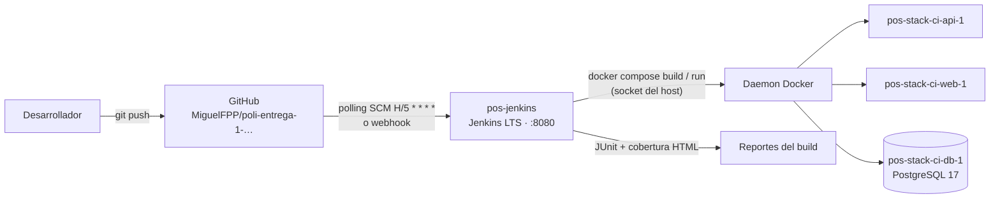

# Integración continua — Jenkins

> **Propósito:** describir el servidor de integración continua del proyecto, la
> integración con GitHub y Docker, el pipeline que se ejecuta en cada cambio y
> los reportes que produce. Corresponde al **Entregable 2 — Escenario 5**.
>
> **Documentos relacionados:** [Arquitectura](ARQUITECTURA.md) · [Docker](DOCKER.md) · [API](API.md) · [README](../README.md)

## Índice

- [Vista general](#vista-general)
- [Requisitos](#requisitos)
- [Puesta en marcha](#puesta-en-marcha)
- [Configuración como código](#configuración-como-código)
- [Plugins](#plugins)
- [El pipeline](#el-pipeline)
- [Reportes](#reportes)
- [Integración con GitHub](#integración-con-github)
- [Aislamiento del entorno](#aislamiento-del-entorno)
- [Docker-outside-of-Docker](#docker-outside-of-docker)
- [Operación](#operación)
- [Solución de problemas](#solución-de-problemas)

## Vista general



Tres piezas del entregable y cómo encajan:

| Componente | Papel en la integración continua |
| :--------- | :------------------------------- |
| **GitHub** | Origen del código. Jenkins clona la rama configurada y detecta cambios por `polling` (`H/5 * * * *`) o por webhook. |
| **Docker** | Entorno de ejecución. El pipeline compila y ejecuta las **mismas imágenes** que usa desarrollo (`apps/api/Dockerfile`, `apps/web/Dockerfile`); no hay un runtime paralelo que pueda divergir. |
| **Jenkins** | Orquestador. Encadena las etapas, corta el build en el primer fallo y publica los reportes de ejecución y errores. |

El controlador de Jenkins **no compila**: solo lanza `docker compose` contra los
contenedores del proyecto. Así el entorno de CI es el mismo que el de desarrollo.

## Requisitos

| Requisito | Detalle |
| :-------- | :------ |
| Docker Engine 29+ con Compose v5 | Ya requerido por el proyecto. |
| Puerto `8080` libre | Consola de Jenkins. `50000` se usa para agentes entrantes. |
| Acceso al socket de Docker | `/var/run/docker.sock` se monta en el contenedor. |
| Git y curl en la imagen | Incluidos en `ci/jenkins/Dockerfile`. |

## Puesta en marcha

```bash
make ci-up          # crea la red pos-ci-net, construye y arranca Jenkins
make ci-ps          # estado del contenedor
make ci-logs        # logs en vivo
```

Jenkins queda en **http://localhost:8080** con el usuario que definen las
variables de entorno:

| Usuario | Contraseña | Origen |
| :------ | :--------- | :----- |
| `admin` | `Admin123!` | `JENKINS_ADMIN_ID` / `JENKINS_ADMIN_PASSWORD` (valores por defecto de desarrollo) |

Al entrar, el job **`POS — Integración continua`** ya existe y apunta al
`Jenkinsfile` de la raíz del repositorio: no hay que crear nada a mano.

> **Warning:** las credenciales por defecto son solo para desarrollo. En un
> entorno real, exporta `JENKINS_ADMIN_PASSWORD` antes de `make ci-up`.

## Configuración como código

`ci/jenkins/jenkins.yaml` se carga con el plugin **Configuration as Code** y
define el servidor completo sin clics:

| Bloque | Qué configura |
| :----- | :------------ |
| `jenkins.systemMessage` | Mensaje del panel de control. |
| `jenkins.numExecutors` | 2 ejecutores en el controlador. |
| `jenkins.securityRealm.local` | Usuario administrador; sin registro abierto. |
| `jenkins.authorizationStrategy` | `loggedInUsersCanDoAnything`; sin lectura anónima. |
| `jenkins.globalNodeProperties` | `DOCKER_CLI_HINTS`, `BUILDKIT_PROGRESS`. |
| `unclassified.location` | URL pública del servidor. |
| `unclassified.gitHubPluginConfig` | Endpoint de webhook y API de GitHub. |
| `tool.git` | Instalación de Git. |
| `jobs` | Job `pos-ci`: pipeline desde SCM, rama y polling. |

Las variables se inyectan por entorno (`CASC_JENKINS_CONFIG` y las variables de
`ci/docker-compose.yml`), así el mismo YAML sirve para cualquier despliegue.

## Plugins

`ci/jenkins/plugins.txt` declara los plugins que se instalan **durante el build
de la imagen** con `jenkins-plugin-cli`. Las versiones las resuelve el CLI
contra el update center, por lo que no se fija ninguna release.

| Grupo | Plugins |
| :---- | :------ |
| Configuración como código | `configuration-as-code`, `job-dsl` |
| Pipeline | `workflow-aggregator`, `workflow-job`, `workflow-cps`, `workflow-basic-steps`, `pipeline-stage-view`, `pipeline-graph-view`, `ws-cleanup`, `timestamper`, `ansicolor`, `build-timeout` |
| GitHub | `git`, `github`, `github-branch-source`, `plain-credentials`, `credentials-binding` |
| Reportes | `junit`, `cobertura`, `htmlpublisher` |
| Docker | `docker-workflow`, `docker-commons`, `docker-build-step`, `buildx` |

## El pipeline

`Jenkinsfile` en la raíz. Declarativo, con `timeout` de 45 minutos, marcas de
tiempo y `disableConcurrentBuilds()`.

| # | Etapa | Qué ejecuta | Evidencia |
| :- | :---- | :---------- | :-------- |
| 1 | **Checkout** | `cleanWs()` + `checkout scm`; imprime commit, autor, fecha y asunto. | Log del build |
| 2 | **Preparar red y stack** | Crea `pos-ci-net` y limpia ejecuciones previas. | Log |
| 3 | **Docker · Construir imágenes** | `docker compose build api web` con las imágenes de la Entrega 1. | Log |
| 4 | **Calidad · Lint y tipos** | `pnpm lint` y `pnpm typecheck` en API y web, en paralelo. | Log |
| 5 | **Pruebas unitarias · API** | `pnpm test:cov` (Jest, umbral 70/60/70). | `reports/api-unit/junit.xml` |
| 6 | **Pruebas unitarias · Web** | `pnpm test:cov` (Vitest, umbral 60/50/60). | `reports/web/junit.xml` |
| 7 | **Pruebas e2e · API + PostgreSQL** | Crea `pos_test` limpia, migra y corre Supertest. | `reports/api-e2e/junit-e2e.xml` |
| 8 | **Docker · Imágenes de producción** | Build de los stages `prod`. | Log |
| 9 | **Despliegue y humo** | `up -d --wait`, migra, siembra, verifica `web → api` y el health desde Jenkins. | Log |

Cualquier etapa que falle aborta el pipeline y dispara el bloque `failure`, que
publica `docker compose ps -a` y las últimas 80 líneas de logs para diagnosticar
sin entrar al servidor.

## Reportes

| Reporte | Dónde se ve | Archivo |
| :------ | :---------- | :------ |
| Resultado de pruebas (API unitarias) | Pestaña *Tests* del build | `reports/api-unit/junit.xml` |
| Resultado de pruebas (web) | Pestaña *Tests* del build | `reports/web/junit.xml` |
| Resultado de pruebas (e2e) | Pestaña *Tests* del build | `reports/api-e2e/junit-e2e.xml` |
| Cobertura de la API | Enlace *Cobertura API (unitarias)* | `coverage/api-unit/lcov-report/index.html` |
| Cobertura de la web | Enlace *Cobertura Web* | `coverage/web/lcov-report/index.html` |
| Artefactos | Página del build | `reports/**/*.xml`, `coverage/**/lcov.info` |

Los reportes se generan solo cuando `CI=true`, que el pipeline define en su
bloque `environment`; en local las suites no escriben archivos adicionales.

## Integración con GitHub

| Mecanismo | Configuración |
| :-------- | :------------ |
| Repositorio | `GITHUB_REPO_URL` (por defecto el remoto de la Entrega 1). |
| Rama | `GITHUB_BRANCH_SPEC` (por defecto `*/main`). |
| Detección de cambios | `polling` con `POLL_SCHEDULE` (por defecto `H/5 * * * *`). |
| Webhook (opcional) | `http://<host>:8080/github-webhook/` en *Settings → Webhooks*. |

Para trabajar en la rama del entregable:

```bash
GITHUB_BRANCH_SPEC='*/feature/entregable-2-jenkins' make ci-up
```

Si el repositorio es privado, añade una credencial de tipo *Secret text* o
*Username with password* en Jenkins y asígnala al job; el `Jenkinsfile` y el
job DSL ya contemplan el campo de credenciales.

## Aislamiento del entorno

El pipeline no debe chocar con el entorno de desarrollo que el operador tenga
levantado. `ci/docker-compose.ci.yml` lo garantiza:

| Aspecto | Desarrollo (`docker-compose.yml`) | Pipeline (`-p pos-stack-ci` + override) |
| :------ | :-------------------------------- | :-------------------------------------- |
| Contenedores | `pos-db`, `pos-api`, `pos-web` | `pos-stack-ci-db-1`, `pos-stack-ci-api-1`, … |
| Puertos publicados | `5432`, `3001`, `3000` | Ninguno |
| Volumen de datos | `pos-pgdata` | `pos-stack-ci-pgdata` (se borra al final) |
| Red | `pos-net` | `pos-ci-net` (externa, compartida con Jenkins) |

El servidor Jenkins corre en su propio proyecto Compose (`pos-ci-server`), de
modo que el `docker compose down --volumes` del final del pipeline **no puede
apagarlo**.

## Docker-outside-of-Docker

Jenkins usa el socket del daemon del host en lugar de un Docker-in-Docker. Eso
trae dos consecuencias que condicionan el diseño:

1. **`docker compose build` sí funciona.** BuildKit transmite el contexto de
   build desde el cliente, así que el daemon no necesita ver el workspace.
2. **Los bind mounts al workspace no funcionan.** Una ruta como
   `$WORKSPACE/coverage` solo existe dentro del contenedor de Jenkins; el
   daemon del host la resuelve como un directorio vacío.

Por eso `ci/scripts/run-with-reports.sh` lanza el contenedor **sin** `--rm` y
extrae los reportes al terminar con `docker cp`, que deja los archivos con el
UID de quien invoca el CLI (el usuario `jenkins`).

## Operación

| Comando | Efecto |
| :------ | :----- |
| `make ci-up` | Crea la red, construye y levanta Jenkins. |
| `make ci-down` | Detiene Jenkins (conserva el volumen). |
| `make ci-logs` | Sigue los logs. |
| `make ci-ps` | Estado del contenedor. |
| `make ci-build` | Reconstruye la imagen (por ejemplo tras cambiar `plugins.txt`). |
| `make ci-shell` | Shell dentro del contenedor. |
| `make ci-reset` | **Destruye el volumen** y arranca de cero. |
| `make ci-stack-up` | Levanta el stack POS con la configuración de CI. |
| `make ci-stack-down` | Detiene ese stack y borra su volumen. |

## Solución de problemas

| Síntoma | Causa y solución |
| :------ | :--------------- |
| `permission denied` en `/var/run/docker.sock` | El GID de la imagen no coincide con el del host. Exporta `DOCKER_GID=$(stat -c '%g' /var/run/docker.sock)` y `make ci-build`. |
| El job falla con `Unable to find Jenkinsfile` | La rama del job no contiene el `Jenkinsfile`. Revisa `GITHUB_BRANCH_SPEC`. |
| Los reportes no aparecen | El contenedor no generó `reports/`; mira el log de la etapa. Requiere `CI=true`, que el pipeline ya define. |
| Jenkins se reinicia solo | Otro proyecto Compose con el mismo nombre ejecutó `down`. Comprueba que el stack usa `pos-stack-ci`. |
| `buildx Docker CLI plugin not found` | La imagen se construyó sin `docker-buildx-plugin`. Ejecuta `make ci-build`. |
| Los contenedores del pipeline quedan vivos | El post siempre ejecuta `docker compose down`. Si se interrumpió, `make ci-stack-down`. |

## Etiquetas

#jenkins #integracion-continua #ci #docker #github #pipeline
